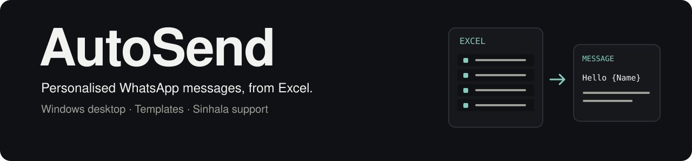

# AutoSend

<div align="center">

<picture>
  <source media="(prefers-color-scheme: dark)" srcset="docs/assets/banner-dark.svg">
  <source media="(prefers-color-scheme: light)" srcset="docs/assets/banner-light.svg">
  
</picture>

[](autosend/__init__.py)
[](#install-for-users)
[](#what-it-does)

**[Install](#install-for-users)** · **[Features](#what-it-does)** · **[Build from source](#build-from-source-for-developers)** · **[Troubleshooting](#troubleshooting)**

</div>

Send personalised WhatsApp messages to a whole list, straight from your Excel sheet. A personal Windows app with a modern
interface, built for non-technical users. English interface, full Sinhala message support.

## What it does
- **Send** to the students you tick, or to a **List**, with a random, human-like rhythm (random pauses, random batch sizes,
  breaks, "typing…", daily limit, sending hours). Pause, stop and resume at any time. Completed sends are recorded so a resumed campaign can continue from its saved progress.
- **Quick send**: type a message and send it, without saving a template.
- **Students**: a live view of your Excel file. Add, edit and delete students and the changes are written back to the
  file (with a backup). Edit the Excel file yourself and the app updates by itself.
- **Lists**: fixed lists and smart lists (rules such as *Class is Grade 9 A* or *Amount is greater than 30000*), including
  non-student contacts and import from Excel/CSV.
- **Templates** and **Variables**: write messages exactly as they should look (line breaks, `*bold*`, Sinhala), with
  `{Name}`, `{Class}`, `{Amount}`... filled in per person. Optional photo.
- **History** with filters (period, class, result), sorting, clearing and Excel export.
- Light and dark mode, and support for Sinhala typing tools such as Helakuru.

## Install (for users)
1. Download `AutoSend-Setup-1.0.0.exe` from the [latest release](https://github.com/thekusaldarshana/AutoSend/releases/latest) and run it.
2. Open AutoSend and follow the welcome steps: choose your Excel file, then scan the QR code with WhatsApp
   (*Linked devices → Link a device*).

Requirements: **Windows 10 (version 1809) or 11, 64-bit**. Nothing else has to be installed: Python, the Visual C++
runtime and the Sinhala font are all included. The installer is unsigned, so Windows SmartScreen may show a warning
the first time (*More info → Run anyway*).

AutoSend is a **personal app**. It installs for the current Windows user only (no administrator rights, no "all users"
option), and its data stays in that user's own `%APPDATA%\AutoSend`.

## First send

1. Choose your Excel workbook and review the detected student and phone columns.
2. Confirm the country code and review the selected recipients or list.
3. Write a template or quick message. Check the preview for each variable, including
   empty cells, Sinhala text, line breaks, and an optional photo.
4. Link WhatsApp with the QR code, review pacing and sending hours, then start.
5. Watch progress and History. Pause or stop when needed; resume the campaign later.

Use a small list of consenting test recipients before sending a full campaign.
Saved progress helps with resuming, but a network error after delivery can make
a retry ambiguous. Review History before retrying uncertain sends.

## Build from source (for developers)

Run the following in PowerShell from a Windows checkout. You need Python with
the `py` launcher and [Inno Setup](https://jrsoftware.org/isinfo.php) for the installer.

```powershell
git clone https://github.com/thekusaldarshana/AutoSend.git
cd AutoSend
```

```powershell
py -m venv .venv
.venv\Scripts\python -m pip install PySide6 neonize openpyxl segno pyinstaller pytest pefile
powershell -ExecutionPolicy Bypass -File build.ps1
```
`build.ps1` runs the tests, packages the app into `dist\AutoSend\`, checks that it starts, and builds the installer into
`installer\output\`. It needs [Inno Setup](https://jrsoftware.org/isinfo.php). Run from source with
`.venv\Scripts\python run_autosend.py`.

The version number lives in one place, `autosend/__init__.py`; the build stamps it on the app and the installer.

| Folder | Contents |
|---|---|
| `autosend/core` | logic without any UI: Excel, phone numbers, templating, pacing, database, WhatsApp link, sending |
| `autosend/ui` | screens, dialogs, theme, the Sinhala typing-tool fix |
| `installer` | Inno Setup script |
| `assets/fonts` | bundled Sinhala font and its licence |
| `tests` | automated tests (they use a fictional sample sheet, never a real student list) |

Useful settings for testing: `AUTOSEND_DATA=<folder>` uses another data folder, `AUTOSEND_SMOKE=<seconds>` makes the app
quit by itself and `AUTOSEND_START_PAGE=<page>` opens a given page.

## Data and configuration

The app keeps its local database, WhatsApp session, history, and logs in
`%APPDATA%\AutoSend`. The source workbook remains your Excel file; edits made
through the app are written back with a backup. Treat both the workbook and
the local data folder as private.

| Variable | Purpose |
| --- | --- |
| `AUTOSEND_DATA` | Use a separate data directory, such as an isolated test folder. |
| `AUTOSEND_SMOKE` | Quit automatically after the given number of seconds for a startup check. |
| `AUTOSEND_START_PAGE` | Open a selected page during development. |

## Troubleshooting

| Symptom | What to check |
| --- | --- |
| WhatsApp is disconnected | Check the connection screen and relink through WhatsApp's Linked devices flow if needed. |
| A recipient is skipped | Review the phone number, missing template values, and skip reason in History. |
| Sending pauses | Check sending hours, the daily cap, and connection failures before resuming. |
| Excel changes cannot be saved | Check whether another application has locked the file and whether the folder is writable. |
| The build stops at the installer step | Install Inno Setup in a location searched by `build.ps1`. |

## Licences
See [THIRD_PARTY_NOTICES.md](THIRD_PARTY_NOTICES.md). AutoSend is not affiliated with WhatsApp or Meta.
